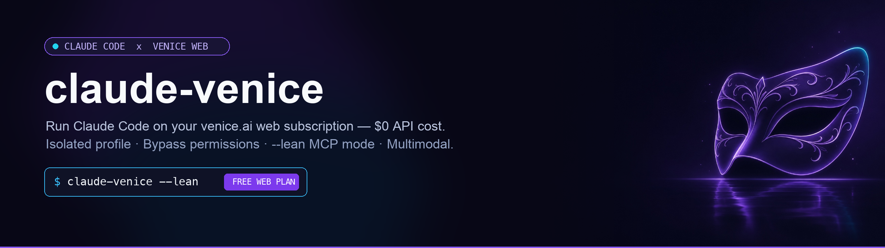
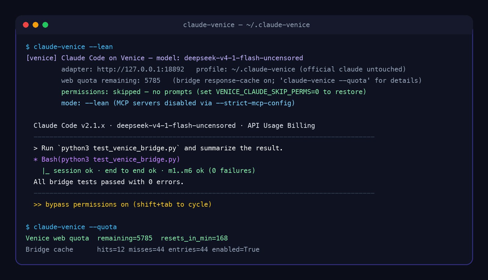

<p align="center">
  
</p>

<p align="center">
  <a href="https://github.com/nsozturk/claude-venice/releases"></a>
  
  <a href="LICENSE"></a>
  
  <a href="AGENTS.md"></a>
  
</p>

<p align="center">
  <code>claude-code</code> <code>venice-ai</code> <code>claude-venice</code> <code>zero-api-cost</code>
  <code>anthropic-messages</code> <code>venice-bridge</code> <code>coding-agent</code> <code>bypass-permissions</code>
  <code>mcp-lean</code> <code>macos</code>
</p>

claude-venice is a free, open-source Claude Code CLI launcher for macOS that runs Claude Code against a local venice-bridge web subscription in an isolated profile with zero API cost.

Documentation site: <https://nsozturk.github.io/claude-venice/> · Backend bridge: [venice-bridge](https://github.com/nsozturk/venice-bridge) · Agent contract: [AGENTS.md](AGENTS.md) · Changelog: [CHANGELOG.md](CHANGELOG.md)

## Screenshots

<p align="center">
  
</p>

## Why `claude-venice`?

- **100% isolated profile (`~/.claude-venice`):** Sets `CLAUDE_CONFIG_DIR` and `CLAUDE_HOME` to `~/.claude-venice` and unsets `ANTHROPIC_API_KEY`. Your official `claude` login, Opus/Sonnet sessions, and settings are never touched.
- **Zero-prompt automation by default:** Passes `--dangerously-skip-permissions --permission-mode bypassPermissions` automatically — including when resuming older sessions with `--resume <id>` — so fast Venice models do not stall on Claude Code's auto-mode safety classifier.
- **`--lean` MCP mode:** Passes `--strict-mcp-config --mcp-config '{"mcpServers":{}}'` to keep the tool schema block compact on repositories with `.mcp.json`, improving tool-call accuracy and speed.
- **Preflight health & quota guard:** Verifies both `venice-bridge` (`127.0.0.1:18891`) and `venice-adapters` (`127.0.0.1:18892`) before starting Claude Code, and warns when fewer than 500 daily web requests remain.
- **Full `venice-bridge` feature support:** Works with multimodal image/PDF attachments, `:web` / `:xsearch` / `:think` model tags, `venice-auto` local Ollama fallback, and response caching.

## Prerequisites

1. [Claude Code CLI](https://docs.anthropic.com/en/docs/claude-code) (`claude` on `PATH`).
2. Running [`venice-bridge`](https://github.com/nsozturk/venice-bridge) (`127.0.0.1:18891`) and `venice-adapters` (`127.0.0.1:18892`).

## Quick Start

```bash
git clone https://github.com/nsozturk/claude-venice.git
cd claude-venice
chmod +x claude-venice
ln -s "$PWD/claude-venice" ~/.local/bin/claude-venice

# Start Claude Code on Venice (default: deepseek-v4-1-flash-uncensored)
claude-venice

# Lean mode (disables MCP servers for tighter tool calling)
claude-venice --lean
```

## CLI Usage & Flags

| Command / Flag | What it does |
|---|---|
| `claude-venice` | Launches Claude Code in `~/.claude-venice` with `deepseek-v4-1-flash-uncensored` and `bypassPermissions`. |
| `claude-venice --lean` | Disables all MCP servers (`--strict-mcp-config --mcp-config '{"mcpServers":{}}'`). Works anywhere before `--`. |
| `claude-venice -m <model-id>` | Overrides the Venice model (e.g., `qwen-3-8-27b`, `z-ai-glm-5-3-flash`, `deepseek-v4-1-flash-uncensored:web`, `venice-auto`, or `ollama/qwen3:8b`). |
| `claude-venice --resume <id>` | Resumes a previous session and forces `bypassPermissions` so sessions saved in `default` mode do not revert to interactive prompts. |
| `claude-venice --models` | Prints every model ID currently exposed by `venice-bridge`. |
| `claude-venice --quota` | Prints remaining daily Venice web quota (`remaining`, `resets_in_min`) and bridge response-cache stats. |
| `VENICE_CLAUDE_SKIP_PERMS=0 claude-venice` | Restores interactive permission prompts (turns off default bypass flags). |
| `VENICE_CLAUDE_MODEL=<id> claude-venice` | Sets the default model from the environment. |

> [!WARNING]
> **`claude-venice` skips permission prompts by default** (`--dangerously-skip-permissions --permission-mode bypassPermissions`). Shell commands and file edits run with your user permissions without asking. Use it only in workspaces where you accept autonomous changes, or pass `VENICE_CLAUDE_SKIP_PERMS=0` / `--permission-mode default`.

## Architecture

```text
claude-venice (Bash launcher, ~/.claude-venice profile)
  └──► claude CLI  ──POST /v1/messages──►  venice-adapters (:18892)
                                              └──► venice-bridge (:18891)
                                                     └──► venice.ai web session
```

## Self-Test

```bash
python3 test_claude_venice.py
```

## Alternatives / Compared With

- **Official Claude Code (Anthropic Pro/Max/API):** Far stronger reasoning and native tool calling, but metered by Anthropic subscription or API tokens. `claude-venice` is a zero-API-cost companion for high-volume exploration and throwaway runs.
- **[`claude-code-local` (`ccl`)](https://github.com/nsozturk/claude-code-local):** Runs Claude Code against local Ollama or LM Studio weights offline. `claude-venice` uses Venice's cloud web models (and can still route to `ollama/<model>` via `venice-bridge`).
- **OpenCode / Codex CLI on `venice-bridge`:** Connect directly to `/v1/chat/completions` or `/v1/responses`. `claude-venice` keeps Claude Code's exact UX, slash commands, and tools intact.

## FAQ

### How do I run Claude Code with Venice AI on Mac without an API key?
Start [`venice-bridge`](https://github.com/nsozturk/venice-bridge) (`127.0.0.1:18891`) and `venice-adapters` (`127.0.0.1:18892`) with your `venice.ai` browser cookie, then run `claude-venice`. No Anthropic or Venice paid API key is required.

### Does `claude-venice` touch my normal `claude` login or settings?
No. It isolates everything inside `~/.claude-venice` (`CLAUDE_CONFIG_DIR` and `CLAUDE_HOME`) and unsets `ANTHROPIC_API_KEY`.

### Why does `claude-venice` enable `bypassPermissions` by default?
Claude Code's `auto` mode relies on a safety classifier prompt that fast Venice web models cannot evaluate reliably, causing blocked tool calls. Pairing `--dangerously-skip-permissions --permission-mode bypassPermissions` keeps both fresh and `--resume` sessions running smoothly. Set `VENICE_CLAUDE_SKIP_PERMS=0` to restore prompts.

### When should I use `--lean`?
Use `claude-venice --lean` in repositories that configure many MCP servers (`.mcp.json`). Disabling unused MCP tools keeps the prompt's `[TOOLS]` block small and prevents argument-schema truncation.

## License

MIT — see [LICENSE](LICENSE).
